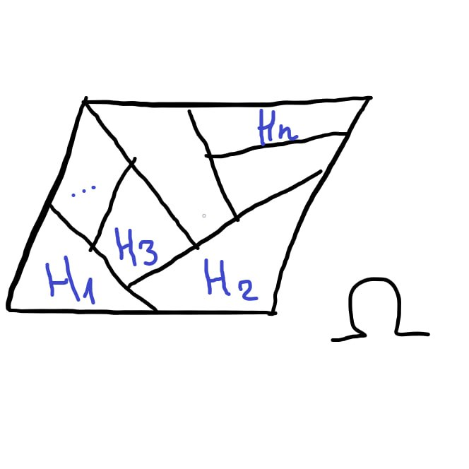

# Полная группа событий

Пусть $H_1, \dots, H_n$ — [события](../Случайное%20событие/Случайное%20событие.md), связанные с некоторым [случайным экспериментом](../Случайный%20эксперимент.md).

**Определение:** Будем говорить, что [события](../Случайное%20событие/Случайное%20событие.md) $H_1, ..., H_n$ образуют **полную группу событий**, если:
1. $H_i \cdot H_j = \emptyset$ при $i \neq j$ ([попарно несовместны](../Случайное%20событие/Несовместные%20и%20совместные%20события.md))
2. $H_1 + ... + H_n = \Omega$ 

**Замечание:** При этом [события](../Случайное%20событие/Случайное%20событие.md) $H_1, \dots, H_n$ называются **гипотезами**.