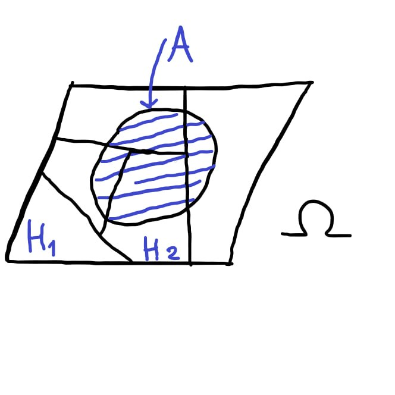

# Формула полной вероятности

## Теорема:
Пусть:

1. $H_1, \dots, H_n$ — [полная группа событий](Полная%20группа%20событий.md),
2. $P(H_i) > 0$, $i = \overline{1, n}$,
3. $A$ — некоторое [событие](../Случайное%20событие/Случайное%20событие.md), связанное с тем же [экспериментом](../Случайный%20эксперимент.md).

Тогда: 

$$ P(A) = P(A \mid H_1)P(H_1) + ... + P(A \mid H_n)P(H_n) $$

— **формула полной вероятности**

## Доказательство

По [свойству дистрибутивности умножения относительно сложения](../Случайное%20событие/Случайное%20событие.md):

$$ A = A \cdot \Omega = A \cdot (H_1 + ... + H_n) = A H_1 + ... + A H_n $$

Так как $H_i H_j = \emptyset$ при $i \neq j$ и $A H_i \leq H_i$:

$$ (A H_i) \cdot (A H_j)  = \emptyset $$

По [аксиоме сложения](../Определения%20вероятности/Аксиоматическое%20определение%20вероятности.md):

$$ P(A) = P(A H_1 + ... + A H_n) = P(A H_1) + ... + P(A H_n) $$

Используя [формулу умножения вероятностей](../Условная%20вероятность/Формула%20умножения%20вероятностей.md) $P(A H_i) = P(A \mid H_i) P(H_i)$:

$$ P(A) = P(A \mid H_1) P(H_1) + ... + P(A \mid H_n) P(H_n) $$

$\blacksquare$

---
## Пример

В магазине продаются телевизоры 3-х фирм:

- **30%** произведены 1-ой фирмой
- **50%** произведены 2-ой фирмой
- **20%** произведены 3-ей фирмой

Известно, что продукция:

- 1-ой фирмы содержит **7%** брака
- 2-ой фирмы содержит **5%** брака
- 3-ей фирмы содержит **10%** брака

**Какова вероятность того, что случайно выбранный телевизор будет бракованным?**

## Решение

Пусть $A = \left\lbrace\text{куплен бракованный телевизор}\right\rbrace$.

Рассмотрим [полную группу событий](Полная%20группа%20событий.md) (гипотезы):

- $H_1 = \left\lbrace\text{купленный телевизор произведён 1-ой фирмой}\right\rbrace$
- $H_2 = \left\lbrace\text{купленный телевизор произведён 2-ой фирмой}\right\rbrace$
- $H_3 = \left\lbrace\text{купленный телевизор произведён 3-ей фирмой}\right\rbrace$

$H_1, H_2, H_3$ — [полная группа событий](Полная%20группа%20событий.md), $P(H_i) > 0$, $i = \overline{1, 3}$

Тогда:

$$ P(A) = P(A \mid H_1)P(H_1) + P(A \mid H_2)P(H_2) + P(A \mid H_3)P(H_3) = $$

$$ = 0.07 \cdot 0.3 + 0.05 \cdot 0.5 + 0.1 \cdot 0.2 = $$

$$ = 0.021 + 0.025 + 0.02 = 0.066 $$
