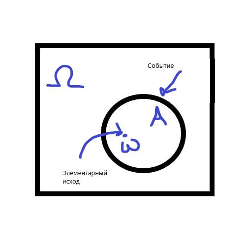
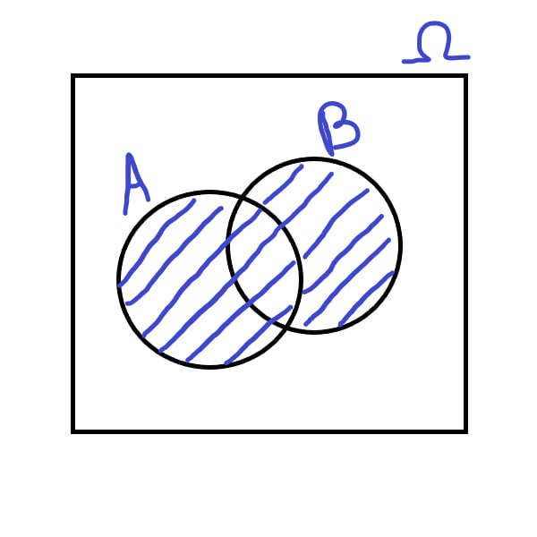
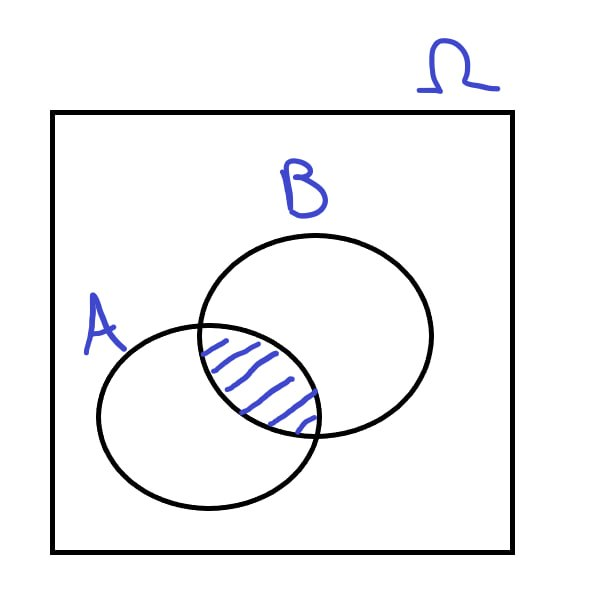
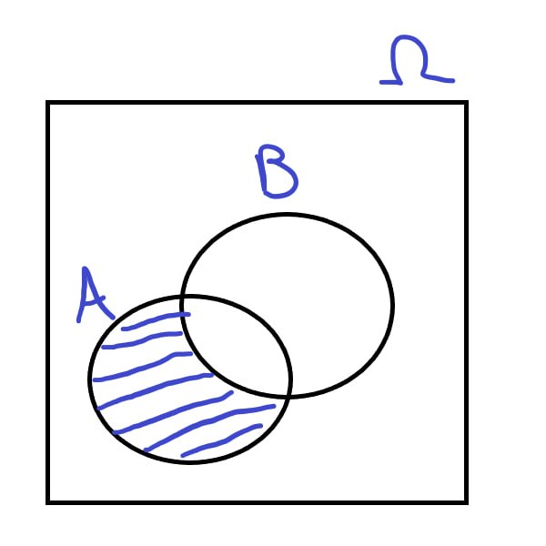
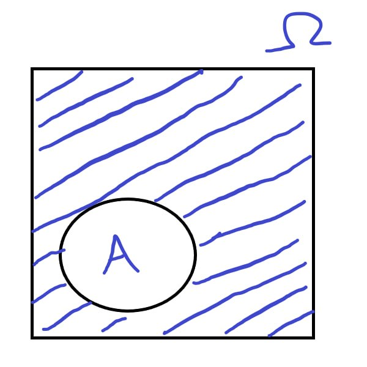

# Случайное событие

## Определение (не строгое): 

**Случайным событием** называется любое подмножество [пространства элементарных исходов](../Пространство%20элементарных%20исходов.md) $A \subseteq \Omega$.

Говорят, что в результате [эксперимента](../Случайный%20эксперимент.md) произошло случайное событие $A \subseteq \Omega$, если имеет место один из входящих в подмножество $A$ исходов.

---
## Невозможное и достоверное события
Любое множество $\Omega$ содержит подмножества $\emptyset$ и $\Omega$. Соответствующие этим подмножествам события называются **невозможным** $(\emptyset)$ и **достоверным** $(\Omega)$. Эти события называются **несобственными**, тогда как все остальные — **собственные**.

**Пример:** Из урны, содер. 2 синих и 3 красн., на удачу вынимают 1 шар.
События:
- $A = \left\lbrace\text{извлечение белого шара}\right\rbrace$ — **невозможное событие**
- $B = \left\lbrace\text{извлечение красн. или синего шара}\right\rbrace$ — **достоверное событие**

---
## Операции над случайными событиями

**1. Объединение случайных событий $A$ и $B$  называется суммой $A \cup B = A + B$**

**Суммой случайных событий $A$ и $B$** называется случайное событие, которое состоит в том, что в ходе [случайного эксперимента](../Случайный%20эксперимент.md) произойдёт хотя бы одно из событий $A$ или $B$.  

**2. Пересечение случайных событий $A$ и $B$ называется произведением $A \cap B = A \cdot B$**

**Произведением случайных событий $A$ и $B$** называется случайное событие, которое состоит в том, что в ходе [случайного эксперимента](../Случайный%20эксперимент.md) произойдут и событие $A$, и событие $B$ одновременно.

 **3. Разность случайных событий $A$ и $B$ называется $A \setminus B$**

**Разностью случайных событий $A \setminus B$** называется случайное событие, которое состоит в том, что в ходе [случайного эксперимента](../Случайный%20эксперимент.md) произойдёт  событие $A$, но не произойдёт событие $B$.

**4. Дополнение случайного события $\bar{A} = \Omega \setminus A$**

**Дополнение случайного события** $A$ называется такое событие $\bar{A}$, что $\bar{A} = \Omega \setminus A$ - противоположное событие. **Противоположное событие** — событие, которое состоит в том, что в результате случайного эксперимента событие $A$ не происходит.

---
## Основные свойства операций над событиями

**Коммутативность:**

1. $A + B = B + A$
2. $A \cdot B = B \cdot A$

**Ассоциативность:**

1. $(A + B) + C = A + (B + C)$
2. $(A \cdot B) \cdot C = A \cdot (B \cdot C)$

3. $\overline{\overline{A}} = A$

**Идемпотентность:**

1. $A + A = A$
2. $A \cdot A = A$

**Дистрибутивность:**

1. $A \cdot (B + C) = A \cdot B + A \cdot C$
2. $A + B \cdot C = (A + B)(A + C)$

**Законы де Моргана:**

1.  $\overline{A + B} = \bar{A} \cdot \bar{B}$
2.  $\overline{A \cdot B} = \bar{A} + \bar{B}$

3. $A \subseteq B \iff A \cdot B = A$

4. $A \subseteq B \iff A + B = B$

5. $A \subseteq B \iff \bar{B} \subseteq \bar{A}$
